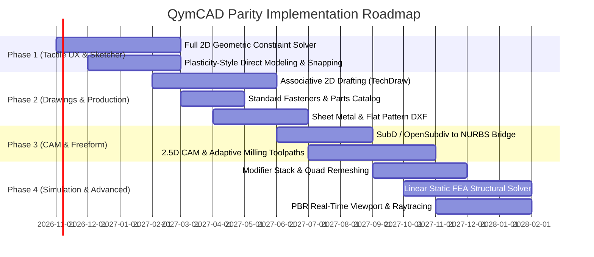

# QymCAD Master Parity Checklist: Reaching the Level of FreeCAD, КОМПАС-3D, Fusion 360, Plasticity 3D & Blender

This master checklist defines the strategic and technical requirements needed to elevate QymCAD from a parametric B-Rep solid modeler into an industry-grade, multi-paradigm CAD/CAE/CAM and 3D design ecosystem comparable with **FreeCAD**, **КОМПАС-3D**, **Autodesk Fusion 360**, **Plasticity 3D**, and **Blender**.

---

## 1. Executive Capability Matrix & Baseline

| Capability Domain | Target Benchmark Software | Current QymCAD Baseline | Parity Milestone Target |
|---|---|---|---|
| **Live Feature Preview & 3D Manipulators** | **Fusion 360** / **SolidWorks** | Modal parameter boxes, no live ghost cut | Real-time translucent boolean cuts, 3D drag arrows/rings for depth/dia, in-viewport HUD dimensions & reference snapping |
| **Direct NURBS Modeling** | **Plasticity 3D** | Basic edge radius handles & face vectors | Seamless direct push/pull, live tangent fillets, knife cuts, fluid UX |
| **Geometric Constraint Sketching** | **FreeCAD** (Sketcher) | Unconstrained/algebraic parametric sketches | Full 2D DOF solver (coincident, tangent, perpendicular, equal, symmetric) |
| **Production 2D Drawings (Drafting)** | **КОМПАС-3D** / **FreeCAD TechDraw** | No 2D associative drawing generation | Sheet layout, multi-view projections, sections, GD&T, associative BOM |
| **Sheet Metal Design** | **КОМПАС-3D** / **Fusion 360** | Solid modeling only | Base flange, bend relief, K-factor calculation, flat pattern DXF unfold |
| **T-Splines & Organic SubD** | **Fusion 360** / **Blender** | Basic quad/polyhedra mesh representation | OpenSubdiv Catmull-Clark cage, creases, conversion from SubD to NURBS B-Rep |
| **Manufacturing: CAM & Toolpaths** | **Fusion 360** (Manufacturing) | 2D contour offsets & DFM draft rules | 2.5D/3D adaptive clearing, pocketing, drilling, tool library, G-code post |
| **Structural Simulation (FEA/CAE)**| **Fusion 360** / **FreeCAD FEM** | No meshing or stress solver | Tetrahedral meshing, boundary conditions, linear static FEA solver adapter |
| **Procedural Nodes & Modifiers** | **Blender** (Geometry Nodes) | Linear history timeline | Non-destructive modifier stack, procedural node graph, quad remeshing |
| **Photorealistic PBR Viewport** | **Blender** (Eevee/Cycles) / **Fusion 360** | Technical CAD shaded viewport (wgpu) | PBR materials, HDRI environment lighting, contact shadows, ray-tracing |

---

## 2. Interactive In-Context Feature Creation, Live Previews & 3D Manipulators (Fusion 360 / SolidWorks Parity)

*Focus: Direct on-screen manipulation, WYSIWYG live boolean feedback, and in-viewport dimensioning without modal dialogue friction.*

- [ ] **Live Translucent / Ghost Boolean Preview (WYSIWYG)**
  - [ ] Real-time translucent cut volume rendering (red tint for material removal/cut, green/cyan for material addition/boss).
  - [ ] 60 FPS preview updates during handle dragging or parameter adjustments before committing.
  - [ ] X-ray depth perception showing internal blind holes, counterbores, countersinks, and threads inside opaque bodies.
  - [ ] Instant preview toggling / validation check (warning indicators when a cut geometry fails to intersect or creates invalid non-manifold topology).
- [ ] **Interactive 3D Feature Manipulator Gizmos**
  - [ ] **Hole & Pocket Placement Manipulator:**
    - [ ] Planar position handle: click on any face, smoothly drag the feature center across the face.
    - [ ] Interactive Depth Arrow: click-drag along normal to set blind depth, with snapping to "Through All" or "To Next Face".
    - [ ] Interactive Diameter Ring: click-drag outer radius ring to dynamically scale the hole/cylinder diameter.
    - [ ] Tip angle & counterbore handles: draggable arrows to adjust drill tip angle (118°/135°), counterbore depth, and counterbore diameter.
  - [ ] **Extrude / Cut / Revolve Manipulators:**
    - [ ] Dual-direction linear pull arrows for symmetrical or two-sided extrusions.
    - [ ] Interactive rotation arc ring for revolve angles (snap to 90°, 180°, 270°, 360°).
    - [ ] Draft angle handle: pull slider along boundary to taper extruded walls.
- [ ] **In-Viewport Heads-Up Display (HUD) & Floating Dimensions**
  - [ ] Floating numeric pills attached in screen-space next to the 3D manipulator handles.
  - [ ] `Tab`-key cycling between active input fields (e.g., Depth -> Diameter -> Angle) without leaving the viewport or clicking side panels.
  - [ ] Dual reference edge dimensioning: when placing a hole on a face, automatically display dashed dimension lines to the two nearest perpendicular edges, allowing instant numerical positioning.
- [ ] **Dynamic 3D In-Context Snapping During Placement**
  - [ ] Concentric snap: hovering near circular/cylindrical edges snaps feature center directly to the arc center/axis.
  - [ ] Midpoint snap: automatic magnetic snapping to edge midpoints and face centroids.
  - [ ] Coincident/Vertex snap: snapping feature origins to existing vertices, sketch points, or datum points.

---

## 3. Plasticity 3D Parity: Fluid Direct NURBS & Artist-Centric UX

*Focus: Fast, tactile, non-intrusive direct modeling without history friction.*

- [ ] **Fluid Direct Push-Pull & Face Offsets**
  - [ ] Interactive face selection with real-time vector drag (offset, extrude, taper).
  - [ ] Automatic adjacent face healing and tangent extension during direct offsets.
  - [ ] Multi-face simultaneous direct manipulation with synchronous boundary solving.
- [ ] **Live Interactive Fillet & Chamfer System**
  - [ ] Instant interactive edge dragging with live curvature preview.
  - [ ] Support for variable radius fillets along edge trajectories with control points.
  - [ ] Chordal fillets (constant visual width across varying dihedral angles).
  - [ ] Corner setback and patch blending at 3+ edge junctions.
- [ ] **Direct Curve-Driven Operations & Knife Tool**
  - [ ] 3D curve drawing directly on planar and curved B-Rep faces.
  - [ ] Screen-space curve projection and instant knife-split through solids.
  - [ ] Face imprinting: splitting faces without dividing underlying solid bodies.
  - [ ] Instant planar slicing with interactive plane manipulation gizmo.
- [ ] **Advanced Snapping & Alignment Engine**
  - [ ] Dynamic geometric inference: tangent, perpendicular, coincident, mid-point, center of arc.
  - [ ] Construction axes alignment guides (infinite ray inference).
  - [ ] Screen-space grid snapping with dynamic subdivision based on zoom level.
- [ ] **Minimalist Keyboard-Driven UX & Immediate Mode**
  - [ ] Modal shortcut system (e.g. `G` move, `R` rotate, `S` scale, `C` chamfer, `F` fillet).
  - [ ] Numeric input popup on any active transform or drag operation.
  - [ ] Floating pie menus / radial menus for context-sensitive commands.

---

## 4. FreeCAD Parity: Parametric Rigor, 2D Geometric Solver & Modularity

*Focus: Robust 2D constraint solving, open workbench architecture, and full parametric determinism.*

- [ ] **Full 2D Geometric Constraint Solver**
  - [ ] Integration of a robust 2D DOF solver (e.g. Solvespace / PlaneGCS algorithm):
    - [ ] Coincident, Point-on-Object, Collinear.
    - [ ] Parallel, Perpendicular, Tangent, Concentric.
    - [ ] Horizontal, Vertical, Equal Length / Radius.
    - [ ] Symmetry across axis, Midpoint.
  - [ ] Degrees of Freedom (DOF) visual indicator (under-constrained vs fully constrained color coding).
  - [ ] Dimensional constraints driven by algebraic expressions and global spreadsheet variables.
  - [ ] Auto-constraint inference during sketch entity creation.
- [ ] **Topological Naming & Robust Graph Rebuilds**
  - [ ] Deterministic persistent identification for faces, edges, and vertices across feature edits.
  - [ ] Topological naming problem mitigation when parent sketch or feature topology changes.
  - [ ] Diagnostic error visualizer pinpointing broken feature dependencies in the tree.
- [ ] **Modular Workbench / Extension Architecture**
  - [ ] Pluggable workspace system allowing distinct toolbars, panels, and contexts per domain.
  - [ ] Public Rust / C ABI / WASM plugin interface for third-party extensions.
  - [ ] Scripting automation console (Python/Lua or native embedded engine) with macro recording.
- [ ] **B-Rep Surface Modeling Tools**
  - [ ] Ruled surfaces, sweeps along multiple guide curves with continuity (G0, G1, G2).
  - [ ] Lofting across closed and open profiles with tangency control.
  - [ ] Boundary patches (N-sided hole fill with G1/G2 continuity to boundary faces).
  - [ ] Surface trim, extend, sew/knit into watertight solid bodies.

---

## 5. КОМПАС-3D Parity: Production Drafting, Sheet Metal & Industrial Standards

*Focus: Industrial 2D drafting documentation, associative views, standards compliance, and sheet metal.*

- [ ] **Associative 2D Drafting Module (TechDraw / Drawings)**
  - [ ] Drawing sheets with standard formats (A4, A3, A2, A1, A0) and customizable title blocks.
  - [ ] Automatic associative projection views: Front, Top, Right, Isometric from 3D model.
  - [ ] Section views: Full section, Offset/stepped section, Broken/aligned section.
  - [ ] Detail views: Circular/rectangular callout with custom scale magnification.
  - [ ] Break views (for long shafts or structural beams with repetitive cross-sections).
  - [ ] Hidden line removal (HLR) rendering with vector output (SVG, PDF, DXF).
- [ ] **Engineering Dimensions, Tolerances & GD&T**
  - [ ] Linear, diametral, radial, angular, ordinate, and chamfer dimensioning tools.
  - [ ] Fit and tolerance annotations (ISO/DIN/ANSI fits, limits, upper/lower deviations).
  - [ ] Geometric Dimensioning & Tolerancing (GD&T) feature control frames (flatness, circularity, parallelism, true position, runout).
  - [ ] Surface roughness / texture callouts and welding symbols.
- [ ] **Bill of Materials (BOM) & Specifications**
  - [ ] Associative part callout balloons linked directly to assembly structure.
  - [ ] Tabular Bill of Materials generation with auto-numbering, part names, quantities, and materials.
  - [ ] Export BOM to CSV, Excel, and structured JSON.
- [ ] **Sheet Metal Design & Unfolding**
  - [ ] Base flange, edge flange, miter flange, and hem creation.
  - [ ] Bend parameters: bend radius, relief types (tear, rectangular, round), K-factor / neutral axis shift.
  - [ ] Corner relief auto-generation and rip tools.
  - [ ] Flat pattern calculation and 1:1 DXF export for CNC laser/plasma cutting.
- [ ] **Standard Engineering Hardware & Parts Catalog**
  - [ ] Built-in parametric library for ISO, DIN, ANSI standard fasteners:
    - [ ] Bolts, screws, nuts, washers.
    - [ ] Dowel pins, retaining rings, keys, and keyways.
    - [ ] Standard ball and roller bearings.
    - [ ] Structural steel profiles (I-beams, channels, hollow rectangular/circular sections).

---

## 6. Autodesk Fusion 360 Parity: T-Splines, CAM, CAE Simulation & Assemblies

*Focus: Integrated multi-discipline engineering: organic surfaces, machining, stress analysis, and motion.*

- [ ] **T-Splines / Freeform SubD-to-NURBS Bridge**
  - [ ] Polygonal control cage manipulation with box, edge, and vertex extrusion.
  - [ ] Crease control on edges and vertices for mixed hard-surface / organic modeling.
  - [ ] Symmetry planes (axial, radial) maintaining topology synchrony.
  - [ ] One-click lossless conversion from limit surface mesh to watertight NURBS B-Rep solid.
- [ ] **Integrated CAM (Computer-Aided Manufacturing)**
  - [ ] Setup definition: Work Coordinate System (WCS), stock bounding geometry, fixture exclusion.
  - [ ] Tool database: Flat endmills, ball endmills, bull-nose endmills, chamfer tools, spot drills, twist drills.
  - [ ] 2.5D Milling Operations:
    - [ ] Face milling, 2D adaptive clearing, 2D pocketing, 2D contouring, chamfer milling.
    - [ ] Drilling cycles: standard, peck drilling, counterboring, tapping.
  - [ ] 3D Milling Operations:
    - [ ] 3D adaptive roughing, scallop, parallel, pencil finishing.
  - [ ] Toolpath simulation with stock removal visualization and collision detection against holders/clamps.
  - [ ] Configurable post-processors (Grbl, Marlin, Haas, Fanuc, LinuxCNC, Heidenhain).
- [ ] **Integrated Simulation & FEA (Finite Element Analysis)**
  - [ ] Automatic tetrahedral surface & solid meshing from B-Rep geometries.
  - [ ] Physics setup: Fixed constraints, frictionless supports, cylindrical supports, point/distributed loads, hydrostatic pressure.
  - [ ] Material properties assignment (Young's modulus, Poisson's ratio, yield strength, thermal expansion).
  - [ ] Linear static structural solver integration (internal or CalculiX adapter).
  - [ ] Results visualization: Von Mises stress, principal stress, displacement magnitude, Safety Factor heatmap.
- [ ] **Advanced Assembly Kinematics & Collisions**
  - [ ] Complete joint types: Rigid, Revolute, Slider, Cylindrical, Pin-Slot, Planar, Ball.
  - [ ] Motion limits, joint friction, and spring rest states.
  - [ ] Motion links and gear/rack relationships.
  - [ ] Real-time contact sets and continuous collision / interference detection.

---

## 7. Blender Parity: High-End Meshing, Modifiers, Procedural Nodes & Render

*Focus: Mesh modeling flexibility, non-destructive modifiers, node networks, and graphics quality.*

- [ ] **Non-Destructive Modifier Stack**
  - [ ] Architecture for stackable, reorderable geometry modifiers:
    - [ ] Mirror modifier (with merge clipping and custom axis pivot).
    - [ ] Array modifier (linear, circular, curve-deform).
    - [ ] Boolean modifier (union, difference, intersect on meshes with manifold guarantee).
    - [ ] Bevel modifier (by angle or vertex group).
    - [ ] Solidify modifier (uniform thickness shell).
    - [ ] Remesh modifier (Voxel remesher, quad flow remesher).
- [ ] **Procedural Geometry Nodes**
  - [ ] Node-based visual graph editor for algorithmic geometry generation.
  - [ ] Input parameters exposing customizable controls to the viewport UI.
  - [ ] Attribute flow: vertex positions, normals, custom domain tags.
  - [ ] Instance distribution on surfaces/points for complex assemblies and lattices.
- [ ] **Production DCC Export & Quad Meshing**
  - [ ] High-fidelity tessellation engine producing clean quad-dominant meshes from NURBS surfaces.
  - [ ] Vertex normal smoothing and sharp edge preservation (split normals).
  - [ ] Multi-format exchange: OBJ, FBX, glTF 2.0 (with PBR materials), USD/USDA, 3MF, STL.
- [ ] **Physically Based Rendering (PBR) & Visualization**
  - [ ] PBR material definition: Base Color, Metallic, Roughness, Normal Map, Clearcoat, Transmission (glass/acrylic).
  - [ ] Image-based lighting (IBL) with HDRI environment maps and ground plane shadow catching.
  - [ ] Contact ambient occlusion (SSAO) and depth of field in viewport.
  - [ ] Built-in raytracing viewport / offline render pass for marketing presentations.

---

## 8. Cross-Cutting Core Architecture Upgrades

*Focus: The foundation required to execute the above domains without compromising performance or stability.*

- [ ] **High-Performance Multi-Core Kernel Engine**
  - [ ] Multi-threaded evaluation of independent branches in feature/assembly trees.
  - [ ] Decoupled geometric kernel worker processes to protect GUI responsiveness during heavy boolean or mesh operations.
- [ ] **GPU-Accelerated Computation & Picking**
  - [ ] Compute-shader accelerated tessellation and vertex buffer generation.
  - [ ] GPU-based color picking / depth buffer occlusion culling for large assemblies (10,000+ parts).
- [ ] **Unified Undo/Redo & Transactional State**
  - [ ] Deterministic command transaction boundaries with zero state corruption on cancel/failure.
  - [ ] History tree branching and checkpoint bookmarks.
- [ ] **Headless & Cloud/API Automation**
  - [ ] Complete CLI suite for batch conversions, automated drawing generation, and DFM audits.
  - [ ] Model Context Protocol (MCP) and JSON-RPC automation server for AI Agent integration.

---

## 9. Prioritized Roadmap & Release Phasing

